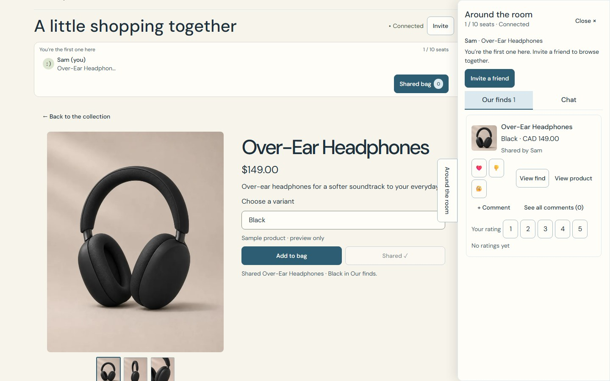

# CoShop

**Shop together while everyone browses independently.** CoShop is a realtime shopping room for friends on a call. Share an exact product variant, discuss it together, and add it to a shared bag when you decide to buy it.

**[Open the live demo](https://coshop-portfolio-preview.vercel.app/)** · No account, installation, or host laptop required.

1. Start a **Sample catalog** room. Open its invite in a private window or on a second device.
2. In the first session, open **Over-Ear Headphones**, choose **Black**, and click **Share find**.
3. In the other session, open **Around the room → Our finds**. Look for **Black · CAD 149.00**. Both bags are still empty.
4. Click **Add to bag** in the first session. Both bag counts become **1**. Refresh the second session to see the find and bag persist.



## How it works

- **React and Vercel** serve the storefront, catalog, Quick add, and product galleries. Each shopper controls their own view.
- **Cloudflare Workers** handle room HTTP requests and direct WebSockets. The invite points to the frontend. Member sessions authenticate in the first WebSocket frame.
- **SQLite-backed Durable Objects** coordinate room state, ordered events, chat and per-variant comments, and reconnect snapshots. Sharing records a find for the exact variant. Adding changes a distinct bag projection. Ordered server acknowledgements and request IDs keep explicit mutations consistent across clients and retries.

The public demo uses a **sample catalog** and a **simulated Haul** with no payment. The optional Shopify integration loads live products through the Storefront API, validates prices and availability, and hands off to hosted checkout. Checkout requires a configured store. A paid recap requires a verified Shopify order webhook. Live checkout was not verified on the public release.

## Run locally

Use Node 24 and pnpm 11.25.0.

```sh
pnpm install --frozen-lockfile
pnpm start
```

Open [localhost:4193](http://localhost:4193). Node creates a local signing secret and room database when needed. For a Cloudflare simulation, copy `.dev.vars.example` to `.dev.vars`, set a local-only signing secret, build, and run `pnpm dev:cloudflare` at [localhost:4194](http://localhost:4194).

```sh
pnpm build                                      # Vite production build and Worker dry run
pnpm test                                       # Node and local Cloudflare transport and domain tests
pnpm exec playwright install chromium
pnpm exec playwright test tests/design.spec.js --workers=1
```

The browser suite defaults to port 4204. Start a preview server with a fresh `DATA_DIR`, `PORT=4204`, `CREATE_LIMIT_PER_HOUR=100`, and `JOIN_LIMIT_PER_10_MIN=150` using `pnpm start:preview`. Set `COSHOP_TEST_URL` to point the browser suite at a different isolated server. Vercel's assets-only command is `node scripts/build.mjs --assets-only`, with output in `dist/client`.

See the [deployment runbook](docs/portfolio-preview.md) for preview isolation, origin settings, and rollback. Keep Shopify credentials, webhook secrets, and invite-signing secrets in server runtime configuration.
