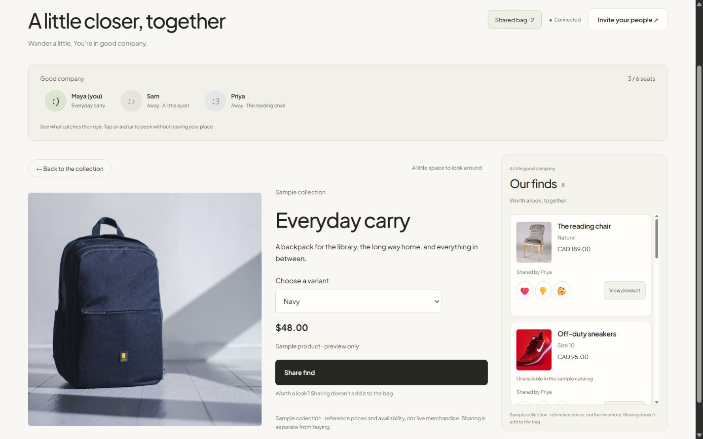
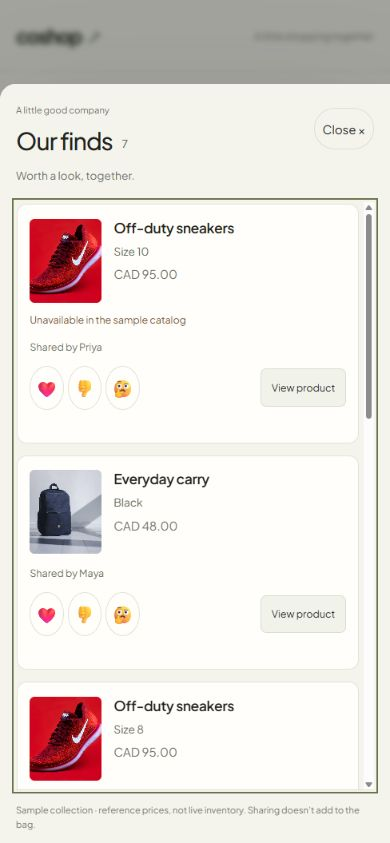
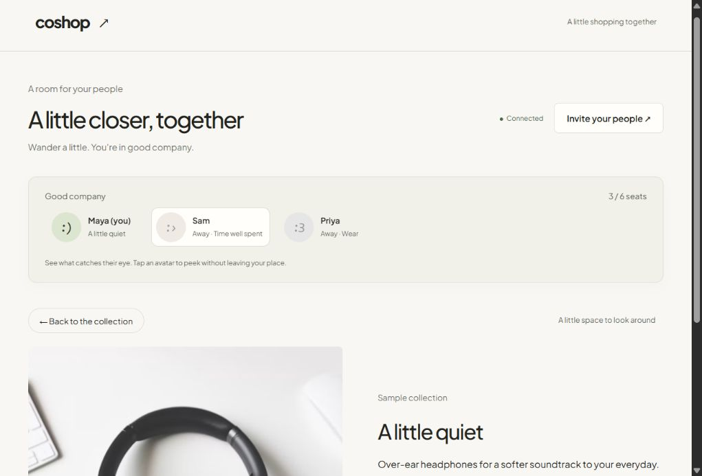

# coshop · Our finds

A shared shopping room for friends already on a call. **Share find** means “worth looking at together.” The persistent **Our finds** collection is separate from the bag: sharing never adds a purchase item. Everyone browses independently, without popups or automatic navigation.

**Current source:** Phase 6. **Start a shopping room** opens the mixed sample collection. **Try Shopify checkout** creates a separate room with live product data and hosted checkout when Shopify is configured. Both Node/SQLite and Cloudflare SQLite Durable Objects use the same room domain. The Node server defaults to **http://localhost:4193**. The older [Sites deployment](https://coshop.valiantartichoke2.chatgpt.site) does not demonstrate this version.

## Phase 6: The haul

Create a sample room, join in a second window, share a find, and have each shopper add something to the bag. Open the bag and choose **Demo completion · simulated**. The recap shows exact variants, quantities, pickers, an estimated total, and up to three most-shared variants. The other shopper sees a banner and can open the same recap; refreshing preserves it. This does not place an order or change the bag.

For paid recaps on a store you control, register an HTTPS `orders/paid` subscription at `/api/shopify/orders-paid`, using an app with order access, and set `SHOPIFY_WEBHOOK_SECRET` to the signing secret for that subscription. Keep it server-side. Include the unfiltered order payload, or retain `admin_graphql_api_id`, `financial_status`, `cart_token`, `note_attributes`, `line_items`, `total_price_set`, `total_price`, and `currency` when configuring the subscription. See Shopify's [webhook reference](https://shopify.dev/docs/api/webhooks/latest) and [signature verification guide](https://shopify.dev/docs/apps/build/webhooks/verify-deliveries).

Only a verified event matching the configured store, checkout marker, and cart token creates a paid recap. The line items and total come from Shopify; picker names and share counts come from the saved room snapshot. Delivery retries are deduplicated, and buyer contact, shipping, and payment details are not retained. Going back from checkout only unlocks the bag. Migration `0007_haul.sql` adds checkout correlation and recap records, both removed with the room. The public demo store's webhook isn't configured, so its checkout handoff does not produce a paid recap on the preview.

## Phase 5: Shopify checkout

Run `pnpm install --frozen-lockfile` with Node 24+. Copy `.env.example` to `.env` for Node or `.dev.vars.example` to `.dev.vars` for local Wrangler and set:

| Variable | Value |
| --- | --- |
| `SHOPIFY_STORE_DOMAIN` | Your store’s `myshopify.com` domain |
| `SHOPIFY_STOREFRONT_TOKEN` | The **public Storefront API token** |
| `SHOPIFY_API_VERSION` | `2026-10` |
| `SHOPIFY_BUYER_COUNTRY` | `CA` by default; choose a country your store serves |

To try Shopify's demo store, copy the public example domain and token from the [Hydrogen documentation](https://shopify.dev/docs/api/hydrogen/2026-04). For your own development store, install **Headless** in Shopify admin, select **Create storefront**, then **Manage API access → Storefront API → Manage** and copy the public token. Publish products to Headless and make them available in the buyer's market. See Shopify's [Storefront setup](https://shopify.dev/docs/storefronts/headless/building-with-the-storefront-api/getting-started) and [Headless channel guide](https://shopify.dev/docs/storefronts/headless/building-with-the-storefront-api/manage-headless-channels). Tokens stay in runtime configuration; do not commit env files.

Start Node with `pnpm start` at **http://localhost:4193** or run `pnpm build` followed by `pnpm dev:cloudflare` at **http://localhost:4194**. Choose **Try Shopify checkout** on the homepage, create a room and look for the store name and **Shopify · CA**. If Shopify is unconfigured or can't load its catalog, the setup form shows an error so you can retry or return to the homepage. **Start a shopping room** always opens the 24-product sample catalog, even when Shopify is configured. Each live room stays with its original store and country. Changing configuration affects new rooms; it cannot send an old room's bag to a different shop.

1. Open two browser profiles or use one of the invite dialog's demo shopper links. Maya chooses an available Shopify variant and presses **Add to bag**. Sam sees the same price, quantity and picker. **Share find** still leaves the bag unchanged.
2. Maya presses **Continue to Shopify**. Sam sees who is checking out and cannot edit the bag. Maya reaches Shopify with the exact bag lines and picker attributes. Stop at checkout; for testing payment, use your own development store with a test gateway.
3. Maya goes Back. The shared bag unlocks without removing any items. The shopper who started checkout can also unlock it, and abandoned locks expire after five minutes. Returning from checkout never marks an order as paid.
4. If Shopify changed price or stock, review the updated bag before trying again. Missing or unavailable lines must be removed by their picker. Shopify warnings, changed cart quantities and subtotal mismatches stop the redirect.

**Implementation:** `shopify.mjs` requests up to 24 products and 24 variants per product with country context. `server/storefront.js` caches catalog reads for 60 seconds; checkout does fresh variant and cart requests. `server/checkout.js` locks the current bag revision, passes buyer country and picker attributes to `cartCreate`, and returns the hosted URL only to the checkout requester. Migration `0006_storefront.sql` adds room catalog snapshots and checkout leases. It leaves existing room, invite, session, find and bag records intact. `app.js` and `client/bag.js` carry the live catalog and checkout states into the existing storefront.

**Phase 4 follow-up:** **+ Comment** opens an inline composer in Our finds. **See all comments** opens the full history for that exact variant, with the same draft. The **Bag** shortcut stays available while browsing and opens the same drawer as **Shared bag** in the header. Search matches product names, descriptions, categories, and variant names across the 24 sample products, within the selected category. Search terms stay on that shopper's device.

## Phase 4: Fill the shared bag

Run `pnpm install --frozen-lockfile` and `pnpm start` with Node 24+ and Shopify settings unset to reproduce the original sample bag flow. Open **http://localhost:4193**. For the local Worker, follow the Cloudflare setup below.

1. Make a room as Maya and join from another browser profile as Sam. Use the invite dialog's demo shopper links if testing on one profile. Optionally join as Priya in a third window.
2. In Maya's window open **A little quiet / Stone** and press **Share find**. Check that the bag remains empty in every window. Now press **Add to bag**. Open **Shared bag** in both windows: it should show quantity **1**, **Picked by Maya**, and a **CAD 149.00** subtotal.
3. As Sam, tap **+** on Stone. Both bags should show quantity **2** and **CAD 298.00** without changing picker or product page. Only Maya has the **−** and **Remove** controls. Maya can reduce it to one, then remove it. If Priya adds **Everyday carry / Navy** separately, it keeps Priya's attribution.
4. Refresh Sam's page and reopen the bag. The last committed quantities and subtotal should match Maya's. On a phone, the drawer can be closed with **Close** or Escape. Try **Off-duty sneakers / Size 10**: you can still share the find, but can't add it.

**Done looks like:** every window agrees on the exact variants, counts, picker tags and estimated subtotal. Additions and edits never navigate other shoppers. Existing bag lines keep their picker; missing or unavailable variants already in the bag are flagged. The sample catalog has reference prices, and there is no checkout in Phase 4.

The existing bag table remains the projection. In `server/bag.js`, each accepted command changes it and appends an add or remove event in one transaction. Add and decrease are relative operations; full removal checks the quantity the picker saw. Retries reuse a request ID, and the event sequence orders snapshots. `client/bag.js` shows edits immediately and reconciles with the server. No migration or reset is required.

## Shop now or leave feedback for later

1. Make a room, share **A little quiet / Stone**, and send a message in **Chat**. Open **Comments** on Stone, leave a comment, and choose a **Your rating** score.
2. Close that tab. Open the same invite in a different browser profile and join as a new shopper. The find, chat history, comment, and rating average are still there. Edit your own score and watch the average change while the rating count stays the same.
3. Open **Around the room** to reach the same tabs on desktop and phone. In a find's thread, **Back to Our finds** restores the list position and button focus. Unsent drafts stay in memory when switching tabs, switching threads, or closing the panel.

Chat and each exact variant's comment thread load the latest 30 messages. **Load earlier messages** pages backward without jumping the reading position; when reading above the bottom, use **New messages** to jump to the latest. Chat text, comments and ratings are retained until room expiry. Anyone admitted via the invite can read the room discussion. Emoji reactions remain separate from ratings, and all discussion leaves the bag alone.

Migration `0005_discussion.sql` adds a discussion log and a current rating per room, stable find ID and shopper. The authenticated WebSocket handles paged reads, server-validated writes, and replay-safe request IDs. Writes and aggregates use one transaction; reconnect reloads the latest page and per-find summaries. **`pnpm test`** covers page boundaries, variant and room isolation, replay, expiry, live broadcasts and reading history after everyone has disconnected in the Node and Cloudflare test environments.



## Try it with three windows

1. Create a room as **Maya**. Use **Invite your people → Testing on one browser?** to open **Sam** and **Priya** as independent demo identities. Normal tabs share one identity; demo tabs retain theirs in session storage.
2. Maya opens **A little quiet / Black**, Sam opens **Time well spent / Tan**, Priya stays in **Wear**. Maya presses **Share find**. Everyone gets one Black headphones card in **Our finds**; nobody is navigated, focused or scrolled. In a new room the bag remains **0**.
3. Have Sam choose **View product** on that card and share it again. It stays in the same position with **Shared by Maya**, plus a brief “Sam shared this again” note. The bag stays unchanged. Share the Stone variant separately: it is a distinct card.
4. Have Maya and Priya share different items close together. All windows should converge on newest-first card order, based on each variant’s first share. Repeats never reorder. Scroll down the list, receive another find, and confirm the same visible card stays in place.
5. React with ❤️ / 👎 / 🤔. A brief emoji floats near that card on devices where the panel is visible. There are no vote totals or verdicts. React to an old find after two minutes too; it still works. Reconnect never replays reaction animations.
6. Above or at **1180px**, the desktop edge tab opens a popout without shifting or locking the storefront. Below **1180px**, the room control opens a modal drawer. New variants increment the local unseen indicator; repeats and snapshots do not. A new share by someone else shows a three-second notice beside the closed opener. Only cards actually visible in **Our finds** while the document is visible become seen. Refresh preserves the viewer’s seen variants when local storage is available.
7. Open the drawer at **390px** and **320px**. Use Tab/Shift+Tab, Escape and Close. Focus stays inside while open, background scroll/interaction is blocked, and closing restores focus to the opener. **View product** closes the drawer and navigates only that shopper to the exact variant. Scroll to reach all cards on short screens.
8. Refresh/reconnect a shopper. All current finds, including old ones, restore with the same first sharer and order. Sharing is disabled during disconnection with an explanation; browsing remains usable. A three-second per-person server cooldown spans that person’s tabs. Existing bag items from the previous version remain intact.

**Run:** Node 24+, then `pnpm install --frozen-lockfile` and `pnpm start` (default port 4193). For the workspace preview use PowerShell `$env:PORT='4195'`, preserving the existing `PUBLIC_ORIGIN` when restarting the tunnel-facing server. Full setup and Cloudflare instructions remain below.

## Implementation and migration

| Kept                                                                                                                                           | Extended/replaced                                                                                                                        |
| ---------------------------------------------------------------------------------------------------------------------------------------------- | ---------------------------------------------------------------------------------------------------------------------------------------- |
| Create/join, equal seats, hashed session credentials, reservations, expiry, presence, Peek/Join, independent navigation and exact variants | Replaced the timed popup/queue in `client/hold-ups.js` with stable keyed cards, local seen state and the responsive panel               |
| Neutral palette, Jakarta font, ASCII artwork, catalog source and browser session storage                                                       | Extended `app.js`, `index.html`, `style.css`, `mobile.css` and the existing command retry feedback                                       |
| Node and Cloudflare hosting and realtime handlers                                                                                              | Extended `server/hold-ups.js`, `server/rooms.js`, `server.mjs`, `worker.mjs` and added migration 4                                       |
| Existing applied SQL and historical bag/event records                                                                                          | Updated Phase 3 domain/transport tests; replaced queue tests with `tests/phase3-finds.test.mjs`; foundation setups now apply migration 4 |

The internal **hold_up** command/event identifier now means the visible **Share find** action. This avoids changing the event type CHECK constraint or invalidating historical requests. Accepted shares remain append-only events, and cooldown/idempotency checks remain scoped to the authenticated person and room.

Migration **0004_shared_finds.sql** adds a unique `(room_id, variant_id)` projection pointing to the first and latest share events. It backfills **all** historical shares, keeping the first event’s sharer and sequence. Repeats update only the latest event pointer; card order comes from the first event sequence. The projection is maintained in the same synchronous transaction as the share event on both runtimes. This avoids scanning every repeated share to build every snapshot. Migrations 1–3, historical events, session hashes and bag records are unchanged.

New shares write **no bag rows or add_to_bag events**. Bag quantity, ownership and revision remain unchanged for first shares, repeats and reactions. Phase 4's separate **Add to bag** control is the explicit way to add a pick. Finds are never reconstructed from bag_lines. Room expiry removes the projection before deleting events/participants, and Cloudflare expiry deletes object storage.

Reconnect snapshots contain the complete **finds** collection for the room lifetime. No two-minute replay window or popup queue remains. Live notifications carry the authoritative card and ordered event; request retries reuse the same ID and cannot duplicate an event/card. Product metadata comes from the canonical server catalog, never client-submitted prices or identities.

Desktop uses a 440px nonmodal popout with an independently scrolling list. Stable DOM nodes preserve focused controls. An anchor correction preserves the visible card when new variants are prepended; repeat notes reserve fixed space. Mobile reparents the same panel into a native modal dialog, with explicit boundary key handling and scroll/focus restoration. An IntersectionObserver plus viewport/document-visibility checks mark only visible cards seen. That local set is saved per room/participant in browser local storage; no server read receipts are introduced.

## Verified results and limits

- All **51 automated checks** pass, including the actual Node and Wrangler HTTP/WebSocket runtimes, simultaneous same-variant shares, persistent reconnect state, request replay, cross-tab cooldown, canonical metadata, old reactions, projection expiry and migration preservation. All room, security, presence and existing Shopify-client regressions still pass.
- Three independent browser identities converged on the same ordered cards. New shares did not change the historical two-item bag. A repeat retained Maya’s attribution. View product navigated only its viewer. No incoming modal or focus change occurred. A fresh room also produced one card with bag quantity zero.
- At a scrolled desktop position, a new card preserved the same visible anchor within subpixel rounding (0.2px), page scroll and keyboard focus. Unseen state survived refresh and ignored repeats.
- Mobile checked at **390×844**, **320×568** and **320×360**, including close/Escape, both keyboard boundaries, exact unavailable variant navigation and reachable bottom-card controls. No horizontal overflow observed. Stopping/restarting the preview left browsing usable, disabled sharing with reconnection guidance, then restored all seven finds and identities. These are browser viewport checks, not physical iPhone tests.
- Reduced-motion CSS removes reaction animation and card/button transitions. The available browser tools did not expose motion-preference emulation; that mode was not manually toggled.
- The existing **sample catalog remains reference data**, clearly labelled in browsing and the panel. No live merchandise, price or stock verification is claimed. Live Shopify catalog/cart wiring remains Phase 5; this redesign adds no checkout, recap or bag editor.





## Phase 2: try it with three windows

Use the same Node setup below, or the Cloudflare local runtime. Both apply migration 2 automatically. The current workspace preview is **http://localhost:4195**. To restart it in PowerShell after stopping the running server:

```powershell
$env:PORT='4195'
node server.mjs
```

1. Create a room as **Maya**. Open **Invite your people → Testing on one browser?** and use the two demo links for **Sam** and **Priya**. Refresh keeps each identity; ordinary tabs on the same browser share one identity.
2. In Maya's tab open **A little quiet**. In Sam's tab open **Time well spent** and select **Tan**. In Priya's tab choose the **Wear** category. Everyone's people strip should show these different places within about one second. No other product/category page should move.
3. From Maya's headphones page, tap Sam's avatar. **Peek** shows the watch, Tan variant and sample price. Close Peek: Maya should still be looking at the same headphones and variant; Sam stays on his watch and Priya stays in Wear.
4. Open Sam's Peek again and select **Join Sam here**. Only Maya should move to the watch, with **Tan** selected. Both watch pages show the other person's small avatar under **At this rack with you**. Tapping a nearby avatar also opens Peek.
5. Change Sam's variant while his Peek is open elsewhere. The Peek updates, while the viewer's underlying page stays put. The Join button uses the latest displayed location. A category Peek can join that category. Unavailable variants show a clear note and remain viewable; missing catalog items disable Join.
6. Leave Sam's tab untouched for 30 seconds. The other tabs should dim Sam's avatar and label it **Away**, retaining his last product. Move/click/type in Sam's page: he becomes active again. This is an activity signal only; no cursor coordinates, scroll position or search text is sent.
7. Navigate Sam's tab away and back to simulate disconnect without clearing demo session storage. His avatar gently exits the strip, but the room still reserves his seat for ten minutes. Returning restores the same identity and its saved product/variant. Refresh a product page: your own last accepted location returns without moving anyone else.
8. Test at phone width: the people strip stays sticky and horizontally scrollable; product pages and Peek remain usable. Invite links work between devices on the same Wi-Fi using the laptop's Wi-Fi address. A localhost URL opens only on this computer.

**Done looks like:** Maya, Sam and Priya browse independently; their location labels update promptly; Peek never changes a page; Join changes only the joiner's page and exact variant; same-product avatars appear; away/disconnect/reconnect behave correctly.

## Phase 2 implementation and acceptance

- One append-only event log derives presence. Only authenticated connections can record a view, using server-validated catalog IDs and categories. Client-supplied names/prices/images/identities are ignored.
- The server accepts at most one new view every **500 ms per participant across all tabs**. Clients coalesce rapid changes and keep the latest destination, retry throttled proposals, and reuse request IDs when acknowledgements are lost. Replays cannot duplicate an event or change its meaning.
- Navigation and idle changes send small participant deltas. Full snapshots are used for joining, membership changes and reconnect. Heartbeat-only traffic does not repeatedly broadcast a catalog or whole room.
- Product pages remain inside the storefront so the sticky presence strip stays usable. No leader/follower controls, approval counts, comparison board, or remote navigation commands return.
- Real interaction and heartbeat timestamps are separate. Idle is derived on the server; Cloudflare alarms deliver away transitions even when no one navigates. The Node adapter uses a lightweight timer. Browser page-hide/page-show handling closes sockets before the back/forward cache freezes a page and reconnects when it returns. Multiple tabs still occupy one seat, and any active tab can keep the identity active.
- Peek is local UI state. Opening/closing it sends no navigation event. Join publishes only the viewer's new location; the destination shopper has no special role or powers.

| Phase 2 check                                                         | Result                                                                                             |
| --------------------------------------------------------------------- | -------------------------------------------------------------------------------------------------- |
| Append-only canonical views, identity scoping, validation             | Passed                                                                                             |
| Server throttle across multiple connections and idempotent replay     | Passed                                                                                             |
| Latest product/category/variant restored from SQLite                  | Passed                                                                                             |
| Heartbeat versus 30-second idle, wake and multi-tab behavior          | Passed                                                                                             |
| Expiry deletes event records; migration preserves existing identities | Passed                                                                                             |
| Actual Node and Cloudflare runtime, three clients                     | Passed: location deltas delivered within one second locally; away and reconnect snapshots verified |
| Client rapid navigation coalescing and stale-socket rejection         | Passed                                                                                             |
| Browser Peek preserves underlying page; Join moves only viewer        | Passed with Maya on headphones, Sam on Tan watch, Priya in Wear                                    |
| Browser refresh and nearby avatars                                    | Passed: same watch variant restored, other shoppers stayed put                                     |
| Browser away, navigation exit and Back                                | Passed: 30-second away labels, immediate exit, reserved seat and same-identity recovery            |
| Phone viewports                                                       | Passed: Peek and Join at 390px, sticky strip at 320px, no horizontal overflow; browser emulation   |

Phase 2 file changes:

| Files                                                                                           | Purpose                                                                                               |
| ----------------------------------------------------------------------------------------------- | ----------------------------------------------------------------------------------------------------- |
| `server/events.js`, `drizzle/room-object/0002_presence.sql`                                     | Shared event log, canonical view records, request replay and throttle                                 |
| `server/rooms.js`, `server/storage.js`, `server/config.js`, `server/realtime.js`                | Derived location/idle, activity clocks, versioned migrations, compact deltas and cleanup              |
| `server.mjs`, `worker.mjs`                                                                      | View acknowledgements, broadcasts, away timers/alarms and assets                                      |
| `client/presence.js`                                                                            | Stable avatar strip, live Peek, Join and same-product avatars                                         |
| `client/realtime.js`, `client/rooms.js`, `app.js`                                               | Coalesced navigation, state reconciliation, independent product/category pages and refresh restore    |
| `index.html`, `style.css`                                                                       | Sticky people strip, inline product page, category filters and responsive Peek                        |
| `docs/phase2-peek.jpg`, `docs/phase2-phone-peek.jpg`                                            | Desktop and phone browser proof using fictional identities                                            |
| `tests/phase2-*.test.mjs`, `tests/support/rooms.mjs`                                            | Phase 2 invariants, real-runtime checks and client queue tests; shared harness extracted from Phase 1 |
| `tests/phase1-domain.test.mjs`, `tests/phase1-transport.test.mjs`                               | Run foundation checks against the migrated schema; original acceptance assertions retained            |
| `package.json`, `.github/workflows/check.yml`, `scripts/build.mjs`, `.env.example`, `README.md` | Full checks, build label, documented idle configuration and this handoff                              |

This section records the preceding Phase 2 work. Its presence and browsing behavior remain in Phase 3.

## Run with Node

Requires Node 24+ and pnpm 11.25.0. If needed, install pnpm with `npm install --global pnpm@11.25.0`.

```sh
pnpm install --frozen-lockfile
pnpm start
```

Open **http://localhost:4193**. The handoff preview in the current workspace uses **http://localhost:4195** because an older demo was using port 4193. In PowerShell, choose a port with `$env:PORT='4195'` before `pnpm start`.

The server binds to `0.0.0.0` for testing with phones on the same Wi-Fi. Open `http://YOUR-LAPTOP-WIFI-IP:4193` on both devices, substituting the chosen port. Keep the laptop running. Setting `HOST=127.0.0.1` restricts it to this computer. Clipboard access may be unavailable on a plain-HTTP phone connection; the invitation field supports selecting and copying manually.

No account or Shopify key is needed for Phase 3. Local data lives in ignored `data/phase1/rooms.sqlite`, separate from the old demo database. A random signing key is generated once in ignored `data/phase1/server-key` unless you supply `INVITE_SIGNING_SECRET`. Keep that key stable across restarts so existing invitations continue to verify. Do not commit it.

Optionally copy `.env.example` to `.env`. Empty `INVITE_SIGNING_SECRET` uses the generated local key. `DATA_DIR` can select another local database directory.

## Test with three browser windows

1. In window A, open the app, select **Start a shopping room**, optionally name it, enter **Maya**, choose an avatar and select **Make room**. Expect one connected person and the “You're the first one here” message.
2. Select **Invite your people**, then **Testing on one browser?** Open **demo shopper 1** and **demo shopper 2** in separate tabs/windows. These use separate demo session-storage keys, so one browser can represent three people. On separate devices or browser profiles, use the ordinary invite instead.
3. In B join as **Maya** with Clay; in C join as **Priya** with Lilac. Expect **Maya**, **Maya 2**, and **Priya**, the chosen avatars, and **3 / 10 seats** in every window. No one is a host or leader.
4. Refresh B. Expect **Maya 2 (you)** and still three seats. Normal tabs on the same browser share the same saved identity; they are not new participants.
5. Temporarily stop the server. Every window should retain its visible room and show **Reconnecting…**. Restart using the same data directory/key. Each window should reconnect automatically, receive a complete current snapshot, and retain its identity. **Retry now** retries immediately.
6. To test seats, navigate a demo tab away and back, or temporarily disconnect a real device. Its seat stays reserved for ten minutes after the final connection is lost. A silent network failure is detected after the heartbeat timeout. Returning during the reservation restores the person; after release, a valid old identity can return only if there is space. Demo identities persist across refresh/back navigation, but closing the demo tab ends its session storage; normal identities persist in local storage.
7. To test the limit, use ten separate browser profiles/devices, or distinct `guest` values in the invite URL to create ten demo identities. An eleventh gets the full-room screen. Existing seated members can still refresh a full room. Reserved disconnected seats count toward ten. The six avatars can be reused.
8. Open `/?room=invalid` to see the invalid-link screen. To test expiry quickly, use a **separate test data directory** with `ROOM_TTL_MS=10000`; leave it untouched for ten seconds, then retry the invite. Expect the expired-room screen. Do not use a short TTL on a database whose rooms you want to keep.

**Done looks like:** three distinct identities appear consistently, refresh never duplicates them, reconnect restores the current room, and simultaneous attempts cannot exceed ten seats.

## Automated verification

```sh
pnpm build
pnpm test
node --test tests/shopify.test.mjs
```

`pnpm test` runs all 51 checks. It exercises the shared domain against SQLite and runs actual HTTP/WebSocket clients against **both Node and Wrangler's local Durable Object runtime**, including a race for the last seat and concurrent shares. It does not replace Cloudflare with an in-memory fake. Tests use disposable databases and require ports 14294–14297, 14304–14305 and 14314–14315 to be available, plus each Wrangler port +1000 for its inspector.

Room foundation acceptance results, retained in this build:

| Check                                       | Result                                                                                             |
| ------------------------------------------- | -------------------------------------------------------------------------------------------------- |
| Simultaneous joins with nine occupied seats | Exactly one accepted, one refused; ten persisted, on both backends                                 |
| Valid/invalid session tokens                | Same person restored / invalid rejected without a room snapshot                                    |
| Duplicate names, Unicode, unsafe input      | Numbered names preserved; HTML/control characters rejected                                         |
| Ten seats and reserved-seat readmission     | Enforced; released identity refused when room has filled                                           |
| Multiple tabs for one identity              | One person; closing one connection does not disconnect the other                                   |
| Inactivity and cleanup                      | Heartbeats do not extend expiry; participant/connection rows deleted; expired invites stay expired |
| Actual Cloudflare-runtime expiry            | Expired responses remain HTTP 410 after storage deletion                                           |
| Creation/join abuse controls                | Expiring atomic counters; no stored raw IPs                                                        |
| Three real browser tabs                     | Joined, synchronized and refreshed without duplication                                             |
| Browser reconnect after server restart      | All three recovered automatically with the same identities                                         |
| Browser responsive checks                   | 390px and 320px, no horizontal overflow; not physical iPhone testing                               |
| Build                                       | Worker bundle and static assets build successfully                                                 |

There are **17 room-foundation tests**, **15 Phase 2 tests**, **14 Phase 3 tests**, and **5 existing Shopify-client regression tests**. Shopify regressions use fixtures; they are not a live Shopify verification of this phase. GitHub Actions installs dependencies, builds the Worker, then runs these checks.

## Data and concurrency

Production target: **one SQLite-backed Durable Object per room**, with hibernating WebSockets. Its synchronous transaction commits capacity checks and participant inserts together. There is no second D1 copy of room state. A second Durable Object class handles expiring abuse counters, addressed by a temporary keyed hash of the source IP and time window.

The Node adapter uses built-in `node:sqlite`, the same SQL schema, and `BEGIN IMMEDIATE` transactions. Room metadata is in `room_records`; identities in `participants`; live connection leases in `connections`. Only display names and the optional room title are user-entered text. Avatars are preset identifiers. There are no emails, accounts, recordings, raw stored IP addresses, or user-agent profiles. Logs do not record bodies or tokens; direct Cloudflare observability is disabled in the configuration.

Migrations: [`0001_rooms.sql`](drizzle/room-object/0001_rooms.sql), [`0002_presence.sql`](drizzle/room-object/0002_presence.sql), [`0003_hold_ups.sql`](drizzle/room-object/0003_hold_ups.sql) and [`0004_shared_finds.sql`](drizzle/room-object/0004_shared_finds.sql). They run at Node startup / object initialization and record schema versions 1–4. Version 2 adds the shared event log and a separate connection activity timestamp. Version 3 adds the bag projection and a room/event index. Version 4 adds/backfills persistent shared finds without changing old bags, events or token hashes. Future changes need new migrations, not edits to an applied version. `wrangler.jsonc` also declares the `v1-rooms` SQLite class migration. Original D1 SQL files/journal remain unchanged for the legacy deployment.

Room activity means creation, a new join, or a real interaction in the room. Heartbeats, reconnect attempts, snapshots and avatar connection updates do not keep an abandoned room alive. Room expiry deletes application records; Durable Object expiry also deletes the object's storage. No expired participant/event archive or identity-bearing tombstone is retained. The `events` table stores append-only `view`, `hold_up` (Share find), `react`, `add_to_bag` and `remove_from_bag` events with room/user/product/variant IDs, canonical JSON payloads and server timestamps. Presence is derived from each participant’s latest view. All shared-find rows, bag lines and events are deleted with the room.

A valid signed invitation to an absent room produces **expired**; a forged/malformed invitation produces **invalid**. This distinction needs no expired-user records. Node performs periodic cleanup; Durable Objects use alarms. Access is denied at the expiry deadline even if background cleanup runs slightly later.

Membership tokens contain 256 random bits and are stored as SHA-256 hashes on the server. Invitation signatures and membership tokens are separate credentials. API authentication uses a Bearer header; WebSockets authenticate in the first frame, never the URL or WebSocket subprotocol. Only an authenticated connection receives room state. Incoming origins, body/message sizes, and avatar/name values are checked server-side; names render through `textContent`.

The old UUID + SHA-256 token scheme was cryptographically sound. Phase 1 creates a new room schema/namespace with new tokens; legacy rooms/tokens are not silently mapped by name or imported. The old hosted app remains available while this replacement is tested.

Clients reconnect with exponential backoff and jitter, capped around 15 seconds, and get a full snapshot on every authenticated connection. Default heartbeat interval is 20 seconds; a 65-second missed-heartbeat timeout detects silent loss. Clean disconnects reserve the seat immediately. Connected tabs belonging to one person share one seat. Membership is authoritative on the server; browser storage retains only that browser's credential.

## Configuration

| Variable                   | Default / purpose                                                                                              |
| -------------------------- | -------------------------------------------------------------------------------------------------------------- |
| `INVITE_SIGNING_SECRET`    | Required in production, 32+ random characters; generated/persisted for Node locally                            |
| `PUBLIC_ORIGIN`            | Optional exact public HTTPS origin when a tunnel forwards to Node; arbitrary forwarded headers are not trusted |
| `PORT`, `HOST`             | Node only: `4193`, `0.0.0.0`                                                                                   |
| `DATA_DIR`                 | Node only: `data/phase1`                                                                                       |
| `ROOM_TTL_MS`              | `86400000` — 24 hours without actual activity                                                                  |
| `SEAT_RESERVATION_MS`      | `600000` — ten minutes after disconnect                                                                        |
| `HEARTBEAT_INTERVAL_MS`    | `20000`                                                                                                        |
| `PRESENCE_IDLE_MS`         | `30000` — actual interaction idle threshold; heartbeats do not reset it                                        |
| `HEARTBEAT_TIMEOUT_MS`     | `65000`                                                                                                        |
| `CREATE_LIMIT_PER_HOUR`    | `10` per IP/window                                                                                             |
| `JOIN_LIMIT_PER_10_MIN`    | `60` per IP/window, including invitation/session/connection attempts                                           |
| `SHOPIFY_STORE_DOMAIN`     | Environment configuration only; no hard-coded store                                                            |
| `SHOPIFY_STOREFRONT_TOKEN` | Public Storefront token, never an Admin/private token                                                          |
| `SHOPIFY_API_VERSION`      | Set explicitly; example config uses `2026-10`                                                                  |
| `SHOPIFY_BUYER_COUNTRY`    | Set explicitly; example config uses `CA`                                                                       |

Keep heartbeat interval comfortably below its timeout. Limits apply to a shared source IP, including several devices on one Wi-Fi. A quota response includes `Retry-After`; the interface does not loop aggressively through it.

## Share the demo outside this laptop

A localhost link only works on the device opening it. For temporary remote testing, install Cloudflare's official `cloudflared` binary and start a Quick Tunnel:

```sh
cloudflared tunnel --url http://127.0.0.1:4195 --no-autoupdate --protocol http2
```

Keep the tunnel running. Copy its generated HTTPS origin, then restart the Node server in a second terminal with that exact public origin:

```powershell
$env:PORT='4195'
$env:PUBLIC_ORIGIN='https://YOUR-HOST.trycloudflare.com'
node server.mjs
```

Share the generated HTTPS link, then invite friends from inside that page. The server checks the explicitly configured hostname for HTTPS requests and WebSocket upgrades; it does not broadly allow cross-origin requests or trust arbitrary forwarded-protocol headers. Localhost continues to work.

Quick Tunnels need no Cloudflare account and support this demo's secure WebSocket connections. They are temporary: the URL changes when the tunnel restarts, and access ends if the laptop sleeps or either process stops. This is a Node preview behind a tunnel, not the Durable Object production deployment. The temporary Node tunnel conservatively shares the local proxy's abuse quota across visitors. See [Cloudflare Quick Tunnels](https://developers.cloudflare.com/tunnel/get-started/quick-tunnels/).

Verified through the public HTTPS route: home page, room creation, joining, two authenticated secure WebSocket clients and cross-client presence. Two automated checks cover explicit public-origin handling and invalid origin configuration. Keep deployment values and binaries out of the repository.

## Cloudflare local runtime and deployment

No Cloudflare login is needed for local tests:

1. Copy `.dev.vars.example` to `.dev.vars` and fill `INVITE_SIGNING_SECRET` with 32+ random characters. Generate one with `node -e "console.log(require('node:crypto').randomBytes(32).toString('hex'))"`. Keep it out of chat and Git.
2. Run `pnpm build`, then `pnpm dev:cloudflare`.
3. Open http://localhost:4194. Wrangler persists local Durable Objects under ignored `.wrangler/`.

Direct publication needs a free Cloudflare account because the existing Sites hosting contract exposes D1/R2, not Durable Object bindings. **Do not deploy this source through Sites**: `.openai/hosting.json` identifies the old site and is retained for provenance. Its generated legacy bundle is no longer tracked or produced. `pnpm build` creates `dist/client/` plus the direct Worker bundle `dist/server/worker.js`; Wrangler deploys `worker.mjs` and assets using `wrangler.jsonc`.

When ready to publish:

```sh
pnpm exec wrangler login
pnpm exec wrangler secret put INVITE_SIGNING_SECRET
pnpm deploy:cloudflare
```

Complete Cloudflare login yourself. The signing secret must be stable across deploys. Configure other environment values in Cloudflare's Worker settings. No paid plan or custom domain is required; a `workers.dev` address is sufficient. The app has not been uploaded to a user-owned Cloudflare account by this phase.

Why Durable Objects rather than Supabase: one authoritative room object naturally owns capacity and connection ordering without adding a second provider. The [documented Cloudflare Free plan](https://developers.cloudflare.com/durable-objects/platform/pricing/) includes 100,000 object requests/day, 13,000 GB-s/day, 5 million SQLite rows read/day, 100,000 written/day and 5 GB storage. Workers have a separate 100,000-request daily limit. Exceeding Free limits rejects operations; free does not mean unlimited. Hibernating sockets avoid keeping the object continuously active. Supabase's alternative [Free limits](https://supabase.com/docs/guides/realtime/limits) include 200 concurrent connections and 100 messages/second, with [2 million messages/month](https://supabase.com/docs/guides/realtime/pricing).

## Shopify and later phases

See the Phase 5 setup above for hosted checkout. Coshop doesn't collect payment details or split payments. Shopify owns the checkout page. The sample catalog remains available when Shopify isn't configured.

Legacy `room-domain.mjs`, `scripts/benchmark.mjs`, `scripts/verify-shopify.mjs`, their reports, and the three old domain/room/worker test files describe the previous API. They are retained for reference, are not imported by the current server, and are not part of the current test command. Do not use their historical results as proof of this version. The legacy verifier now reads credentials from environment variables. The original D1 migrations and old screenshots are unchanged.

See Phase 6 above for the difference between simulated and verified paid recaps.

## Phase 1 foundation file handoff

| Files                                                             | What changed / why                                                                                                                             |
| ----------------------------------------------------------------- | ---------------------------------------------------------------------------------------------------------------------------------------------- |
| `index.html`, `app.js`                                            | Replaced old leader/approval/table flow with create, join, avatars, room shell and error screens; retained sample storefront and ASCII artwork |
| `style.css`, `mobile.css`                                         | Additive Phase 1 styles, keeping the neutral palette, typography and artwork                                                                   |
| `client/rooms.js`                                                 | New screen and participant rendering                                                                                                           |
| `client/session.js`                                               | New persisted normal identity / isolated demo identities                                                                                       |
| `client/realtime.js`                                              | New authenticated WebSocket, heartbeat, backoff and resync lifecycle                                                                           |
| `server.mjs`                                                      | Replaced snapshot/polling API with shared room rules, SQLite, WebSockets and local cleanup                                                     |
| `worker.mjs`                                                      | Replaced D1 snapshot API with room/abuse Durable Objects, alarms and WebSockets                                                                |
| `server/rooms.js`                                                 | New authoritative room/admission/reservation/expiry rules and HTTP responses                                                                   |
| `server/participants.js`                                          | New validation, name collision handling and avatar allowlist                                                                                   |
| `server/security.js`                                              | New independent invite/session credentials, hashing and origin checks                                                                          |
| `server/abuse.js`                                                 | New atomic expiring IP-derived quotas                                                                                                          |
| `server/storage.js`, `server/config.js`, `server/realtime.js`     | New shared SQLite adapters, environment config and protocol helpers                                                                            |
| `drizzle/room-object/0001_rooms.sql`, `wrangler.jsonc`            | New SQL schema, class migrations and direct deployment bindings                                                                                |
| `.env.example`, `.dev.vars.example`, `.gitignore`                 | New documented config; ignore secrets, local state and generated output                                                                        |
| `package.json`, `pnpm-lock.yaml`, `pnpm-workspace.yaml`           | WebSocket/runtime dependencies pinned, reproducible install, allow build scripts only for esbuild/workerd                                      |
| `scripts/build.mjs`                                               | Replaced concatenation with static-asset copy and Wrangler validation/bundle                                                                   |
| `.github/workflows/check.yml`                                     | Installs, builds and runs current checks                                                                                                       |
| `tests/phase1-domain.test.mjs`, `tests/phase1-transport.test.mjs` | New invariant, transport, race, expiry and recovery checks                                                                                     |
| `shopify.mjs`, `tests/shopify.test.mjs`                           | Remove hard-coded API version; preserve and check client behavior with explicit config                                                         |
| `room-domain.mjs`, `scripts/verify-shopify.mjs`                   | Mark legacy engine; remove embedded demo credentials from verifier                                                                             |
| `docs/phase1-room.jpg`, `docs/phase1-phone.jpg`                   | New browser proof using fictional demo identities                                                                                              |
| `README.md`                                                       | This phase's complete setup, test procedure, results and scope                                                                                 |

Unchanged source/assets: `catalog.mjs`, `font.woff2`, `OFL-PlusJakartaSans.txt`, historical screenshots/reports, original D1 migrations and Sites identity. Generated `dist/` output is no longer version-controlled. No placeholder files for later phases were added.

## Design credits

Retains the ElevenLabs-inspired neutral direction, bundled Plus Jakarta Sans (SIL OFL), original ASCII interference animation, and illustrative Unsplash sample photography. Preset faces are text, not collected photos. Reduced-motion settings disable animation. Phone checks are browser emulation, not a claim of physical-device testing.
