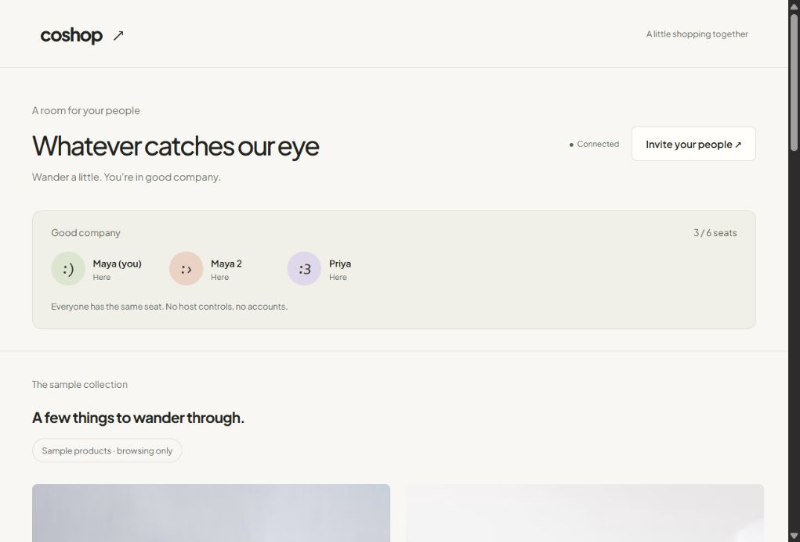

# coshop · Phase 1

A shared shopping room for friends already on a call. This phase implements rooms, identities, six seats, and WebSocket connections. Everyone has equal permissions. Keep Discord or FaceTime open; coshop does not provide calling.

**Current source:** Phase 1, runnable locally with Node or Cloudflare's local runtime. **Not yet published to Cloudflare.** The previous [Sites demo](https://coshop.valiantartichoke2.chatgpt.site) remains an older build; it does not demonstrate this phase.



## Run with Node

Requires Node 24+ and pnpm 11.25.0. If needed, install pnpm with `npm install --global pnpm@11.25.0`.

```sh
pnpm install --frozen-lockfile
pnpm start
```

Open **http://localhost:4193**. The handoff preview in the current workspace uses **http://localhost:4195** because an older demo was using port 4193. In PowerShell, choose a port with `$env:PORT='4195'` before `pnpm start`.

The server binds to `0.0.0.0` for testing with phones on the same Wi-Fi. Open `http://YOUR-LAPTOP-WIFI-IP:4193` on both devices, substituting the chosen port. Keep the laptop running. Setting `HOST=127.0.0.1` restricts it to this computer. Clipboard access may be unavailable on a plain-HTTP phone connection; the invitation field supports selecting and copying manually.

No account or Shopify key is needed for Phase 1. Local data lives in ignored `data/phase1/rooms.sqlite`, separate from the old demo database. A random signing key is generated once in ignored `data/phase1/server-key` unless you supply `INVITE_SIGNING_SECRET`. Keep that key stable across restarts so existing invitations continue to verify. Do not commit it.

Optionally copy `.env.example` to `.env`. Empty `INVITE_SIGNING_SECRET` uses the generated local key. `DATA_DIR` can select another local database directory.

## Test with three browser windows

1. In window A, open the app, select **Start a shopping room**, optionally name it, enter **Maya**, choose an avatar and select **Make room**. Expect one connected person and the “You're the first one here” message.
2. Select **Invite your people**, then **Testing on one browser?** Open **demo shopper 1** and **demo shopper 2** in separate tabs/windows. These use separate demo session-storage keys, so one browser can represent three people. On separate devices or browser profiles, use the ordinary invite instead.
3. In B join as **Maya** with Clay; in C join as **Priya** with Lilac. Expect **Maya**, **Maya 2**, and **Priya**, the chosen avatars, and **3 / 6 seats** in every window. No one is a host or leader.
4. Refresh B. Expect **Maya 2 (you)** and still three seats. Normal tabs on the same browser share the same saved identity; they are not new participants.
5. Temporarily stop the server. Every window should retain its visible room and show **Reconnecting…**. Restart using the same data directory/key. Each window should reconnect automatically, receive a complete current snapshot, and retain its identity. **Retry now** retries immediately.
6. To test seats, navigate a demo tab away and back, or temporarily disconnect a real device. Its seat stays reserved for ten minutes after the final connection is lost. A silent network failure is detected after the heartbeat timeout. Returning during the reservation restores the person; after release, a valid old identity can return only if there is space. Demo identities persist across refresh/back navigation, but closing the demo tab ends its session storage; normal identities persist in local storage.
7. To test the limit, use six separate browser profiles/devices, or distinct `guest` values in the invite URL to create six demo identities. A seventh gets the full-room screen. Existing seated members can still refresh a full room. Reserved disconnected seats count toward six.
8. Open `/?room=invalid` to see the invalid-link screen. To test expiry quickly, use a **separate test data directory** with `ROOM_TTL_MS=10000`; leave it untouched for ten seconds, then retry the invite. Expect the expired-room screen. Do not use a short TTL on a database whose rooms you want to keep.

**Done looks like:** three distinct identities appear consistently, refresh never duplicates them, reconnect restores the current room, and simultaneous attempts cannot exceed six seats.

## Automated verification

```sh
pnpm build
pnpm test
node --test tests/shopify.test.mjs
```

`pnpm test` exercises the shared domain against SQLite and runs actual HTTP/WebSocket clients against **both Node and Wrangler's local Durable Object runtime**, including a race for the last seat. It does not replace Cloudflare with an in-memory fake. Tests use disposable databases and require ports 14294–14297 to be available.

Acceptance results from this build:

| Check                                       | Result                                                                                             |
| ------------------------------------------- | -------------------------------------------------------------------------------------------------- |
| Simultaneous joins with five occupied seats | Exactly one accepted, one refused; six persisted, on both backends                                 |
| Valid/invalid session tokens                | Same person restored / invalid rejected without a room snapshot                                    |
| Duplicate names, Unicode, unsafe input      | Numbered names preserved; HTML/control characters rejected                                         |
| Six seats and reserved-seat readmission     | Enforced; released identity refused when room has filled                                           |
| Multiple tabs for one identity              | One person; closing one connection does not disconnect the other                                   |
| Inactivity and cleanup                      | Heartbeats do not extend expiry; participant/connection rows deleted; expired invites stay expired |
| Actual Cloudflare-runtime expiry            | Expired responses remain HTTP 410 after storage deletion                                           |
| Creation/join abuse controls                | Expiring atomic counters; no stored raw IPs                                                        |
| Three real browser tabs                     | Joined, synchronized and refreshed without duplication                                             |
| Browser reconnect after server restart      | All three recovered automatically with the same identities                                         |
| Browser responsive checks                   | 390px and 320px, no horizontal overflow; not physical iPhone testing                               |
| Build                                       | Worker bundle and static assets build successfully                                                 |

There are **17 Phase 1 tests** plus **5 existing Shopify-client regression tests**. Shopify regressions use fixtures; they are not a live Shopify verification of this phase. GitHub Actions installs dependencies, builds the Worker, then runs these checks.

## Data and concurrency

Production target: **one SQLite-backed Durable Object per room**, with hibernating WebSockets. Its synchronous transaction commits capacity checks and participant inserts together. There is no second D1 copy of room state. A second Durable Object class handles expiring abuse counters, addressed by a temporary keyed hash of the source IP and time window.

The Node adapter uses built-in `node:sqlite`, the same SQL schema, and `BEGIN IMMEDIATE` transactions. Room metadata is in `room_records`; identities in `participants`; live connection leases in `connections`. Only display names and the optional room title are user-entered text. Avatars are preset identifiers. There are no emails, accounts, recordings, raw stored IP addresses, or user-agent profiles. Logs do not record bodies or tokens; direct Cloudflare observability is disabled in the configuration.

Migration: [`drizzle/room-object/0001_rooms.sql`](drizzle/room-object/0001_rooms.sql). It runs at Node startup / object initialization and records schema version 1. Future changes need new migrations, not edits to an applied version. `wrangler.jsonc` also declares the `v1-rooms` SQLite class migration. Original D1 SQL files/journal remain unchanged for the legacy deployment.

Room activity means creation, a new join, or a throttled actual interaction in the room. Heartbeats, reconnect attempts, snapshots and avatar connection updates do not keep an abandoned room alive. Room expiry deletes application records; Durable Object expiry also deletes the object's storage. No expired participant/event archive or identity-bearing tombstone is retained. The event log begins in Phase 2; its foreign keys/cleanup must follow the same room lifetime.

A valid signed invitation to an absent room produces **expired**; a forged/malformed invitation produces **invalid**. This distinction needs no expired-user records. Node performs periodic cleanup; Durable Objects use alarms. Access is denied at the expiry deadline even if background cleanup runs slightly later.

Membership tokens contain 256 random bits and are stored as SHA-256 hashes on the server. Invitation signatures and membership tokens are separate credentials. API authentication uses a Bearer header; WebSockets authenticate in the first frame, never the URL or WebSocket subprotocol. Only an authenticated connection receives room state. Incoming origins, body/message sizes, and avatar/name values are checked server-side; names render through `textContent`.

The old UUID + SHA-256 token scheme was cryptographically sound. Phase 1 creates a new room schema/namespace with new tokens; legacy rooms/tokens are not silently mapped by name or imported. The old hosted app remains available while this replacement is tested.

Clients reconnect with exponential backoff and jitter, capped around 15 seconds, and get a full snapshot on every authenticated connection. Default heartbeat interval is 20 seconds; a 65-second missed-heartbeat timeout detects silent loss. Clean disconnects reserve the seat immediately. Connected tabs belonging to one person share one seat. Membership is authoritative on the server; browser storage retains only that browser's credential.

## Configuration

| Variable                   | Default / purpose                                                                   |
| -------------------------- | ----------------------------------------------------------------------------------- |
| `INVITE_SIGNING_SECRET`    | Required in production, 32+ random characters; generated/persisted for Node locally |
| `PORT`, `HOST`             | Node only: `4193`, `0.0.0.0`                                                        |
| `DATA_DIR`                 | Node only: `data/phase1`                                                            |
| `ROOM_TTL_MS`              | `86400000` — 24 hours without actual activity                                       |
| `SEAT_RESERVATION_MS`      | `600000` — ten minutes after disconnect                                             |
| `HEARTBEAT_INTERVAL_MS`    | `20000`                                                                             |
| `HEARTBEAT_TIMEOUT_MS`     | `65000`                                                                             |
| `CREATE_LIMIT_PER_HOUR`    | `10` per IP/window                                                                  |
| `JOIN_LIMIT_PER_10_MIN`    | `60` per IP/window, including invitation/session/connection attempts                |
| `SHOPIFY_STORE_DOMAIN`     | Environment configuration only; no hard-coded store                                 |
| `SHOPIFY_STOREFRONT_TOKEN` | Public Storefront token, never an Admin/private token                               |
| `SHOPIFY_API_VERSION`      | Set explicitly; example config uses `2026-10`                                       |
| `SHOPIFY_BUYER_COUNTRY`    | Set explicitly; example config uses `CA`                                            |

Keep heartbeat interval comfortably below its timeout. Limits apply to a shared source IP, including several devices on one Wi-Fi. A quota response includes `Retry-After`; the interface does not loop aggressively through it.

## Cloudflare local runtime and deployment

No Cloudflare login is needed for local tests:

1. Copy `.dev.vars.example` to `.dev.vars` and fill `INVITE_SIGNING_SECRET` with 32+ random characters. Generate one with `node -e "console.log(require('node:crypto').randomBytes(32).toString('hex'))"`. Keep it out of chat and Git.
2. Run `pnpm build`, then `pnpm dev:cloudflare`.
3. Open http://localhost:4194. Wrangler persists local Durable Objects under ignored `.wrangler/`.

Direct publication needs a free Cloudflare account because the existing Sites hosting contract exposes D1/R2, not Durable Object bindings. **Do not deploy this source through Sites**: `.openai/hosting.json` identifies the old site and is retained for provenance. Its generated legacy bundle is no longer tracked or produced. `pnpm build` creates `dist/client/` plus the direct Worker bundle `dist/server/worker.js`; Wrangler deploys `worker.mjs` and assets using `wrangler.jsonc`.

When ready to publish:

```sh
pnpm exec wrangler login
pnpm exec wrangler secret put INVITE_SIGNING_SECRET
pnpm deploy:cloudflare
```

Complete Cloudflare login yourself. The signing secret must be stable across deploys. Configure other environment values in Cloudflare's Worker settings. No paid plan or custom domain is required; a `workers.dev` address is sufficient. The app has not been uploaded to a user-owned Cloudflare account by this phase.

Why Durable Objects rather than Supabase: one authoritative room object naturally owns capacity and connection ordering without adding a second provider. The [documented Cloudflare Free plan](https://developers.cloudflare.com/durable-objects/platform/pricing/) includes 100,000 object requests/day, 13,000 GB-s/day, 5 million SQLite rows read/day, 100,000 written/day and 5 GB storage. Workers have a separate 100,000-request daily limit. Exceeding Free limits rejects operations; free does not mean unlimited. Hibernating sockets avoid keeping the object continuously active. Supabase's alternative [Free limits](https://supabase.com/docs/guides/realtime/limits) include 200 concurrent connections and 100 messages/second, with [2 million messages/month](https://supabase.com/docs/guides/realtime/pricing).

## Shopify and later phases

Phase 1 displays the clearly labelled sample catalog. Product selection and variants remain local previews. Presence/peek/join, Hold up, the bag, Shopify checkout and recap are **not implemented by this phase**. No inert purchase controls pretend otherwise. Sound remains absent/muted.

`catalog.mjs`, the reusable Shopify client and legacy storefront domain source are retained. The client now requires an explicit API version; the application config reads all four Shopify values from the environment. The public Hydrogen store can be configured using the public example credentials in [Shopify's official Hydrogen documentation](https://shopify.dev/docs/api/hydrogen/2026-04); they are not embedded in application code. Live catalog caching, country-context pricing, cart warnings and checkout will be wired and verified in Phase 5.

Legacy `room-domain.mjs`, `scripts/benchmark.mjs`, `scripts/verify-shopify.mjs`, their reports, and the three old domain/room/worker test files describe the previous API. They are retained for reference, are not imported by the current server, and are not part of the Phase 1 test command. Do not use their historical results as proof of this version. The legacy verifier now reads credentials from environment variables. The original D1 migrations and old screenshots are unchanged.

Phase 6 will distinguish a verified server-side Shopify order from an explicitly labelled simulated demo completion. Returning from checkout will not count as proof of a purchase. That work is deferred until its phase is approved.

## File-by-file handoff

| Files                                                             | What changed / why                                                                                                                             |
| ----------------------------------------------------------------- | ---------------------------------------------------------------------------------------------------------------------------------------------- |
| `index.html`, `app.js`                                            | Replaced old leader/approval/table flow with create, join, avatars, room shell and error screens; retained sample storefront and ASCII artwork |
| `style.css`, `mobile.css`                                         | Additive Phase 1 styles, keeping the neutral palette, typography and artwork                                                                   |
| `client/rooms.js`                                                 | New screen and participant rendering                                                                                                           |
| `client/session.js`                                               | New persisted normal identity / isolated demo identities                                                                                       |
| `client/realtime.js`                                              | New authenticated WebSocket, heartbeat, backoff and resync lifecycle                                                                           |
| `server.mjs`                                                      | Replaced snapshot/polling API with shared room rules, SQLite, WebSockets and local cleanup                                                     |
| `worker.mjs`                                                      | Replaced D1 snapshot API with room/abuse Durable Objects, alarms and WebSockets                                                                |
| `server/rooms.js`                                                 | New authoritative room/admission/reservation/expiry rules and HTTP responses                                                                   |
| `server/participants.js`                                          | New validation, name collision handling and avatar allowlist                                                                                   |
| `server/security.js`                                              | New independent invite/session credentials, hashing and origin checks                                                                          |
| `server/abuse.js`                                                 | New atomic expiring IP-derived quotas                                                                                                          |
| `server/storage.js`, `server/config.js`, `server/realtime.js`     | New shared SQLite adapters, environment config and protocol helpers                                                                            |
| `drizzle/room-object/0001_rooms.sql`, `wrangler.jsonc`            | New SQL schema, class migrations and direct deployment bindings                                                                                |
| `.env.example`, `.dev.vars.example`, `.gitignore`                 | New documented config; ignore secrets, local state and generated output                                                                        |
| `package.json`, `pnpm-lock.yaml`, `pnpm-workspace.yaml`           | WebSocket/runtime dependencies pinned, reproducible install, allow build scripts only for esbuild/workerd                                      |
| `scripts/build.mjs`                                               | Replaced concatenation with static-asset copy and Wrangler validation/bundle                                                                   |
| `.github/workflows/check.yml`                                     | Installs, builds and runs current checks                                                                                                       |
| `tests/phase1-domain.test.mjs`, `tests/phase1-transport.test.mjs` | New invariant, transport, race, expiry and recovery checks                                                                                     |
| `shopify.mjs`, `tests/shopify.test.mjs`                           | Remove hard-coded API version; preserve and check client behavior with explicit config                                                         |
| `room-domain.mjs`, `scripts/verify-shopify.mjs`                   | Mark legacy engine; remove embedded demo credentials from verifier                                                                             |
| `docs/phase1-room.jpg`, `docs/phase1-phone.jpg`                   | New browser proof using fictional demo identities                                                                                              |
| `README.md`                                                       | This phase's complete setup, test procedure, results and scope                                                                                 |

Unchanged source/assets: `catalog.mjs`, `font.woff2`, `OFL-PlusJakartaSans.txt`, historical screenshots/reports, original D1 migrations and Sites identity. Generated `dist/` output is no longer version-controlled. No placeholder files for later phases were added.

## Design credits

Retains the ElevenLabs-inspired neutral direction, bundled Plus Jakarta Sans (SIL OFL), original ASCII interference animation, and illustrative Unsplash sample photography. Preset faces are text, not collected photos. Reduced-motion settings disable animation. Phone checks are browser emulation, not a claim of physical-device testing.
