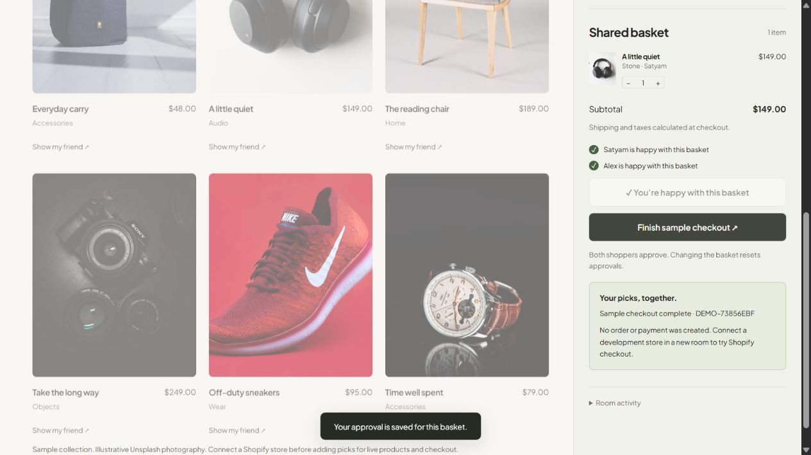

# Shopping Room

[Open the live demo](https://shopping-room-live.valiantartichoke2.chatgpt.site)

Shop with friends while you are on a call. Join a room, follow whoever is leading, and see their selected product and variant change on your screen. Break away to browse independently, take the lead, share finds, and build a basket together.



## Try the complete demo

1. Open the live site, enter your name, and start a room. It supports up to six shoppers.
2. Choose **Invite friends**. Send the link to another device, or use **Open second shopper for demo** to test in another tab.
3. The host starts as the leader. Another shopper selects **Follow [name]**.
4. Open a product and change its option. The follower sees the same product and variant. They can close the product to browse independently, or take the lead themselves.
5. Share a find to the table, react to a pick, and add an item to the basket.
6. Everyone approves the current basket. Changing its contents clears the approvals.
7. Finish the labelled sample checkout, or connect a Shopify development store in an empty room to create a real cart.

Sample checkout creates no order, payment, or Shopify cart. The sample catalog uses fictional products and prices with illustrative photography. Existing rooms created before the group update also remain usable.

## Run locally

Requires Node.js 24 or later. There are no package dependencies.

```sh
node server.mjs
node --test tests/*.test.mjs
```

Open http://localhost:4193. For a phone on the same Wi-Fi, open http://YOUR-LAPTOP-WIFI-IP:4193 on both devices. Keep the laptop running. HOST defaults to 0.0.0.0. Set HOST=127.0.0.1 to restrict access to this computer. PORT defaults to 4193. Local rooms persist in the ignored data/rooms.sqlite database.

## Shopify handoff

The host can select **Connect Shopify** in a new room before adding shared picks or basket items. Supply a development-store domain and public Storefront API token. Publish products to the associated storefront first. The application rejects common private/Admin token prefixes. Never provide Admin or private tokens.

The demo retrieves the first 12 products and up to 100 variants per product through Storefront API 2026-10. It supports one currency per room. Prices and availability are rechecked before cart creation. A changed price clears approvals and asks everyone to review. An unavailable item can be removed without losing other room contents. Returned cart quantities are checked against the requested basket before the Shopify checkout URL is shown. Delivery, taxes, and payment are handled by Shopify.

The automated Shopify checks use fixtures. A live development-store checkout has not been verified because no store credentials have been supplied.

## Synchronization and recovery

The server owns the shared room state. Clients poll every 1.2 seconds while their tab is visible. Browsing publishes the selected variant for each shopper. Follow mode mirrors the current leader and is saved in browser storage, so refreshing restores the mode and retrieves the latest selection. Closing a followed product or selecting your own option exits follow mode.

A temporary connection failure shows a reconnect message and preserves the visible room. The client automatically fetches the latest saved state when it reconnects. The latest queued browsing selection is retried. Basket edits require a working connection. A stale basket mutation is rejected with HTTP 409 rather than silently overwriting another shopper's change.

Room versions cover all shared changes. Basket revisions separately invalidate approvals and checkout results. Browsing changes do not reset basket approvals. Local requests share a per-room action queue. Hosted updates use a D1 compare-and-swap against the previously read room snapshot, protecting writes across Worker isolates. An external cart request can succeed before a conflicting database write is rejected, leaving an unused Shopify cart. The application does not place an order automatically.

Membership uses random bearer tokens. Normal membership is stored in localStorage, and the second-shopper demo uses sessionStorage. The server stores token hashes and strips them from room responses. Clearing browser storage loses that membership. The host's public Storefront token is stored server-side and is omitted from API responses and Git.

## Deployment

The live app runs as a Cloudflare Worker with D1 storage through Sites. Hosted rooms expire after seven days. Room creation is limited to 12 per hour per source IP and mutations to 240 per minute per member. Request bodies are bounded. Expired records and quota buckets are not automatically purged in this demo.

```sh
node scripts/build.mjs
node --check dist/server/index.js
```

The build embeds frontend assets and bundles the same room-domain logic used locally. The hosting manifest declares the D1 binding. SQL migrations are stored under drizzle/. Local SQLite and hosted D1 data are separate. Build and tests run in the GitHub Check workflow.

## Verification

Six automated tests cover the multi-client integration flow, server restart recovery, stale edits, approval invalidation, group capacity, hosted compare-and-swap, token redaction, quotas, invalid browsing selections, and Shopify error/quantity handling.

Browser checks covered hosted product/variant following, follow-mode recovery after refresh, shared sample checkout, and local reconnection after the server was stopped and restarted. Phone-width checks at 390px covered browsing, product selection, adding to the basket, and bottom navigation. A 320px layout check showed no horizontal overflow. These were browser viewport checks, not physical iPhone tests.

[Benchmark results](benchmark-results.json) contain 10 hosted propagation samples. Median was 774 ms and p95/max was 1,039 ms. Measurement ran from publishing an update in one HTTP client to observing it in a separate client polling every 1.2 seconds. This is a small single-machine measurement, not a load test or a browser rendering benchmark. The in-app sync figure is an estimate that adjusts for server clock offset.

```sh
node scripts/benchmark.mjs https://shopping-room-live.valiantartichoke2.chatgpt.site
```

## Boundaries

The app synchronizes its own catalog, not the external Shop app or arbitrary websites. Voice/video calls stay in the caller's preferred app. Variant text is synchronized, while sample photographs do not change with fictional colour/size choices. Presence reports the current client's connection state, not whether every participant is online.

A merchant launch would additionally need installation/OAuth, store-wide catalog coverage, durable request idempotency, seat recovery and removal, database cleanup, operational monitoring, broader device/load testing, and a verified live-store checkout. This repository is a portfolio demo.

## Design and attribution

The monochrome direction references [ElevenLabs ElevenAPI brand guidance](https://elevenlabs.io/brand), with original ASCII interference animation and the app's own identity. Plus Jakarta Sans is bundled under SIL OFL, included in OFL-PlusJakartaSans.txt. Sample photography is served by Unsplash and is illustrative. Connected Shopify stores supply their own product images.
