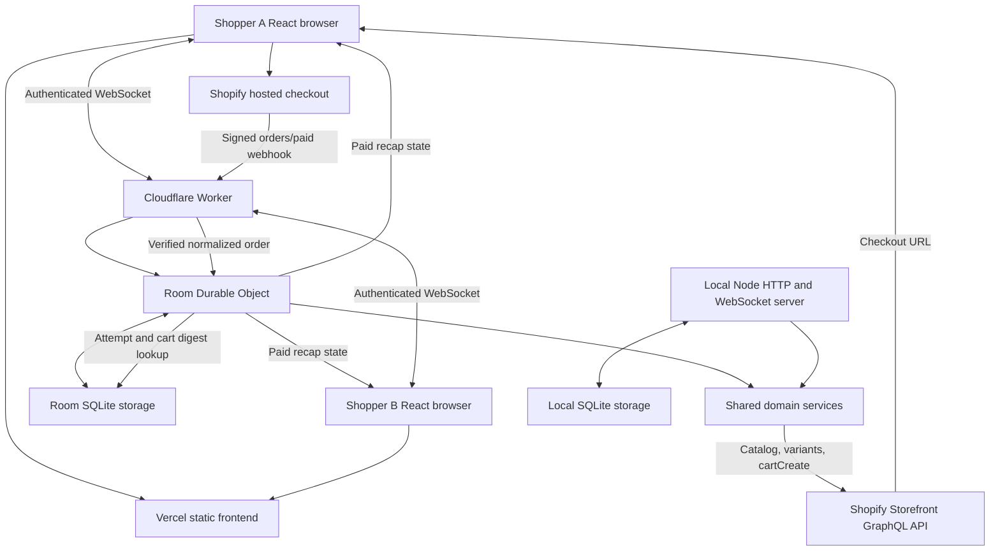

# CoShop architecture

Runtime candidate `f3351ac4cb612aa8bdf2d6bdaf12400d533636a0`, reviewed in [PR #2](https://github.com/SPatel2133/coshop/pull/2). Combined candidate and review gates are recorded in [the work tracker](work-tracker.md).

## Source map

- [Worker entry point](../../worker.mjs) routes rooms to Durable Objects and validates paid webhook requests before forwarding them internally.
- [Local server](../../server.mjs) supplies the Node HTTP and WebSocket transport and local SQLite database. It has a paid webhook handler too.
- [Room domain](../../server/rooms.js) handles authenticated membership, commands, expiry and snapshots. [Realtime helpers](../../server/realtime.js) construct state and presence messages.
- [Finds](../../server/hold-ups.js) and [bag](../../server/bag.js) are separate projections. An explicit add is required to change quantity.
- [Checkout](../../server/checkout.js) acquires a lease, rechecks variants, validates the returned subtotal and host, and saves attribution. [Haul](../../server/haul.js) joins paid orders to checkout snapshots and deduplicates order recaps.
- [Webhook parser](../../server/order-webhook.js) verifies HMAC against raw bytes, store domain and topic, then validates the order payload. [Shopify client](../../shopify.mjs) owns GraphQL calls.
- [Schema migrations](../../drizzle/room-object) define persistent room state and cascading expiry cleanup.

## Verification boundary

The public sample catalog and simulated Haul do not exercise payment. Existing fixture tests use synthetic Shopify responses. A live paid attribution chain remains unproved until a supervised development-store test produces actual order and webhook evidence. The local recovery and attribution fixtures passed independent review. The supervised live test remains pending.
